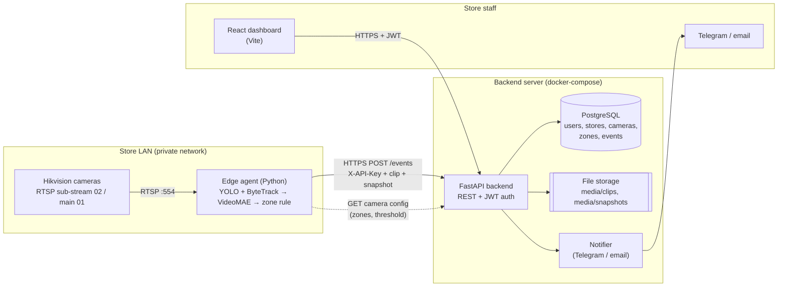
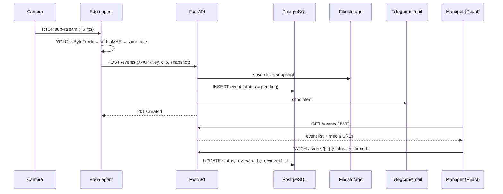

# LUMI – System Architecture

Owner: Shohruh Mamatov · Sprint 1

## 1. Overview

The cameras sit on the store's private network, so a cloud server cannot reach them.
The **edge agent** runs inside the store, does the heavy video work locally and
only sends small, already-flagged events out, which keeps bandwidth and privacy risk low.

## 2. Components

### Hikvision cameras
Existing store cameras. Each channel exposes two RTSP streams:
`rtsp://<user>:<pass>@<ip>:554/Streaming/Channels/<channel><stream>`,
where `01` is the main stream (high resolution, used for saved clips) and `02` is the
sub-stream (low resolution, used for ML).

### Edge agent (`edge-agent/`, reuses `ml/`)
- Reads the sub-stream at about 5 fps.
- **YOLO** (pretrained, person class) detects people; **ByteTrack** gives each person a track ID.
- For each track, builds a 16-frame clip (224×224) and runs the **VideoMAE** classifier
  (normal / shoplifting), using the same preprocessing as training (`inference_config.json`).
- **Zone rule:** raise an alert only if a person flagged for concealment reaches the
  EXIT zone without passing through the CHECKOUT zone.
- Cuts a ~10 s clip from the main stream plus a snapshot and POSTs them to the backend with the
  store's API key. If the backend is unreachable, it queues events locally and retries.

### FastAPI backend (`backend/`)
- REST API: auth (register/login/me, JWT, roles owner/staff), stores, cameras, zones, events.
- Accepts events from edge agents (per-store API key) and from the dashboard (JWT).
- Saves clips/snapshots to file storage and keeps only the **path** in the database.
- Triggers the notifier when a new event arrives.

### PostgreSQL
Source of truth for users, stores, cameras (with encrypted RTSP password and threshold),
zones (checkout/exit polygons) and events (score, status, media paths, reviewer).
Schema changes go through Alembic migrations. See [db-schema.md](db-schema.md).

### File storage
A mounted folder (`MEDIA_DIR`) holding `clips/` and `snapshots/`. Files are served only through
authenticated backend endpoints. This could later move to S3/MinIO without changing the API.

### Notifier
A small module in the backend that sends a Telegram message and/or an email with the
store, camera, time and a link to the review page (Temur's ticket).

### React dashboard (`frontend/`)
Login, live alert list, event log with clip player, review screen (confirm/dismiss),
and camera/zone setup (drawing checkout/exit polygons).

## 3. One alert, end to end

1. The camera streams the sub-stream to the edge agent over RTSP.
2. The edge agent samples about 5 fps, and YOLO + ByteTrack follow person #17.
3. VideoMAE scores person #17's 16-frame clip at 0.82, which is above the camera threshold of 0.6.
4. Person #17 enters the EXIT zone without having entered the CHECKOUT zone, so the zone rule fires.
5. The edge agent cuts a 10 s clip and a snapshot, then sends
   `POST /events` (multipart: camera_id, started_at, score, clip, snapshot) with `X-API-Key`.
6. The backend checks the API key, saves the files to `media/`, and inserts an `events` row
   with `status = pending`.
7. The backend calls the notifier, which sends Telegram/email to the store's staff.
8. The dashboard picks up the new event (polling now, WebSocket later) and shows it.
9. A manager opens the review screen, watches the clip and clicks **Confirm** or **Dismiss**:
   `PATCH /events/{id}` sets `status`, `reviewed_by` and `reviewed_at`.

## 4. Tech stack

| Layer | Choice | Why |
|---|---|---|
| Edge capture | OpenCV (FFmpeg backend) | Reads RTSP streams reliably with a few lines of Python. |
| Detection | YOLO (Ultralytics, pretrained) | Fast and accurate person detection without training our own. |
| Tracking | ByteTrack | Built into Ultralytics and gives stable person IDs, which the zone rule needs. |
| Classifier | VideoMAE (HF Transformers) | Strong video model that fine-tunes on a small dataset like DCSASS. |
| Training | Kaggle notebooks (T4 GPU) | Free GPU, since the team has no local GPU. |
| Backend | FastAPI (Python 3.12) | Same language as the ML code, async, with automatic OpenAPI docs for the frontend. |
| ORM / migrations | SQLAlchemy 2 + Alembic | The standard Python ORM, and migrations keep everyone's DB schema identical. |
| Database | PostgreSQL 16 | Reliable relational DB with good JSON support for zone polygons. |
| Auth | JWT + bcrypt (passlib) | Stateless tokens are simple for a SPA, and bcrypt is the standard for password hashing. |
| Secrets at rest | Fernet (`cryptography`) | Simple symmetric encryption for stored camera passwords. |
| Frontend | React + Vite | Large ecosystem and fast dev server, and it's what the team knows. |
| Alerts | Telegram Bot API + SMTP | Telegram is widely used in Uzbekistan; email is a fallback. |
| Packaging | Docker + docker-compose | One command starts the same stack on every laptop and on the server. |
| Tests / CI | pytest + GitHub Actions | Built-in support in FastAPI (`TestClient`) and free CI for the repo. |

## 5. Security & privacy

- Edge agents authenticate with a per-store API key, and users authenticate with JWT.
- Camera passwords are encrypted in the DB (Fernet). Secrets live only in `.env`.
- Only flagged clips are stored. There is no face recognition.
  Follow Uzbekistan's personal data law (retention limit, access only for the store's staff).
- The system only **flags** events for human review. It never acts automatically.
