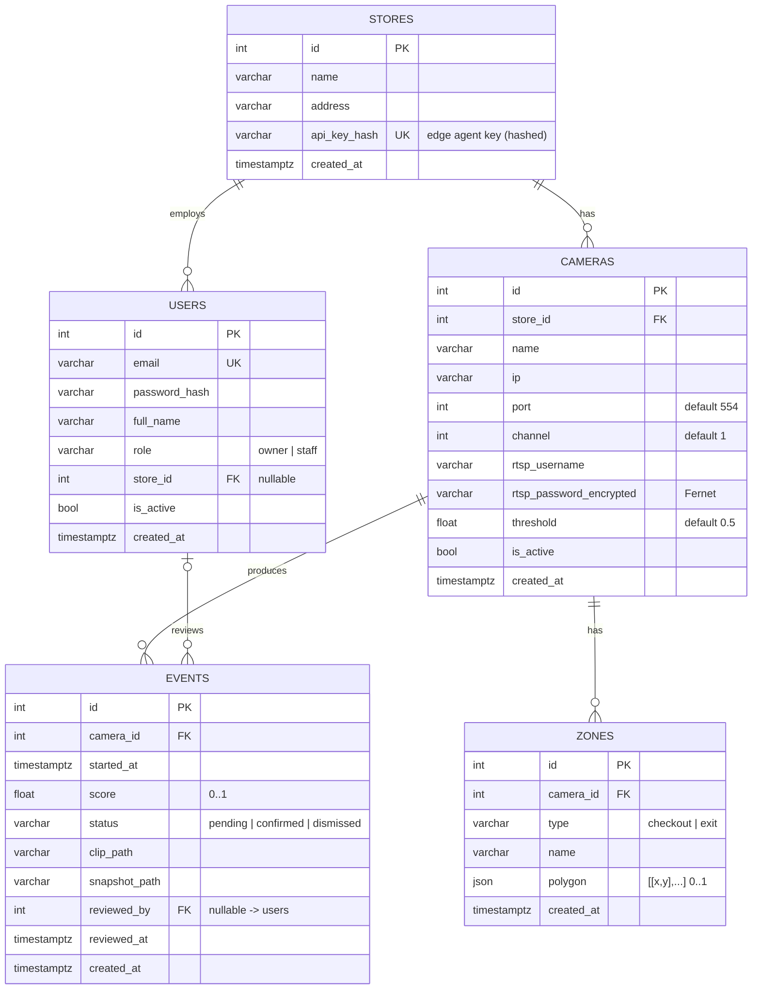

# LUMI – Database Schema

Owner: Shohruh Mamatov · Sprint 1
Source of truth: `backend/app/models.py` · Migration: `backend/alembic/versions/0001_initial_schema.py`

## ER diagram



## Tables

| Table | Purpose | Notes |
|---|---|---|
| `stores` | One physical shop. | `api_key_hash` authenticates that store's edge agent. Only the hash is stored. |
| `users` | Managers and staff who log in. | `role` is `owner` or `staff`. `store_id` is nullable because an owner registers before creating a store. |
| `cameras` | Hikvision cameras in a store. | The RTSP URL is built from `ip`, `port`, `channel` + stream (`02` sub for ML, `01` main for clips). The password is Fernet-encrypted. `threshold` = per-camera sensitivity. |
| `zones` | Checkout / exit areas drawn on a camera view. | `polygon` points are normalised to 0..1 so they don't depend on resolution. |
| `events` | One flagged moment waiting for human review. | Media files live on disk, and only paths relative to `MEDIA_DIR` are stored. |

## Design decisions

- **Enums as VARCHAR + CHECK** (`native_enum=False`) rather than Postgres `ENUM` types, so adding a value later is a simple migration.
- **Timestamps are `timestamptz`** (stored in UTC), and the frontend converts them to local time (Asia/Tashkent).
- **Cascades:** deleting a store deletes its cameras, and deleting a camera deletes its zones and events.
  Deleting a user keeps the events but sets `reviewed_by` to NULL. Deleting a store keeps its users and sets `store_id` to NULL.
- **Indexes:** `users.email` (unique, login), `events(camera_id, started_at)` (event log per camera), `events.status`
  (the "pending" filter), plus each FK used for lookups.
- **Later (backlog):** multiple stores per account becomes a `store_members(user_id, store_id, role)` table,
  and the alert notification log may get a `notifications` table.

## Working with migrations

```bash
cd backend
alembic upgrade head                              # apply all migrations
alembic revision --autogenerate -m "add x"        # after changing models.py; review the file!
alembic downgrade -1                              # undo the last migration
```
